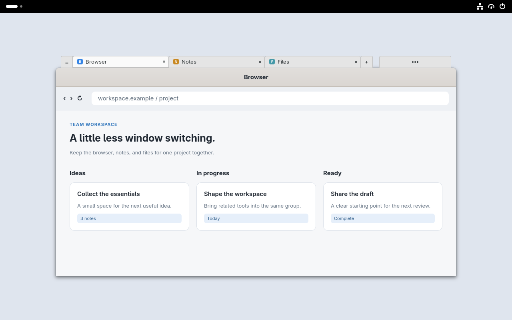
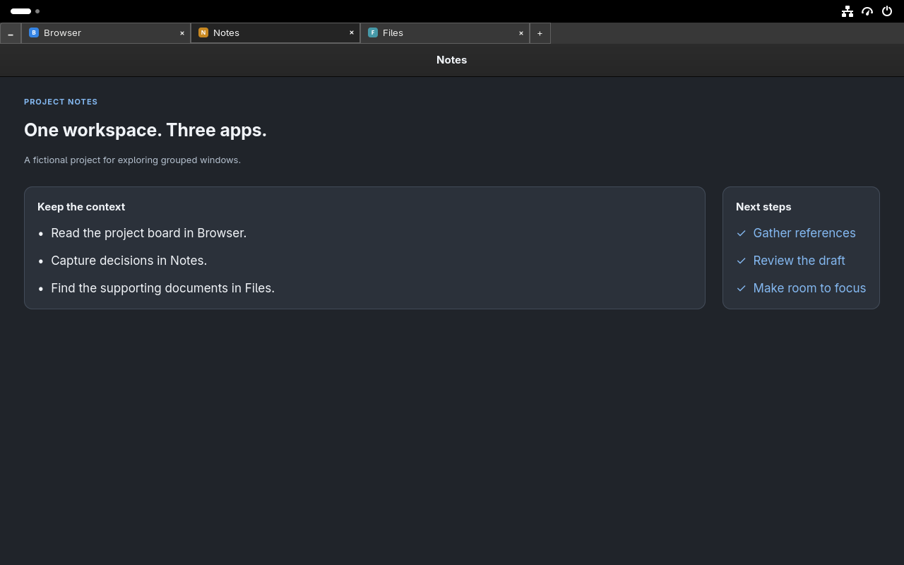
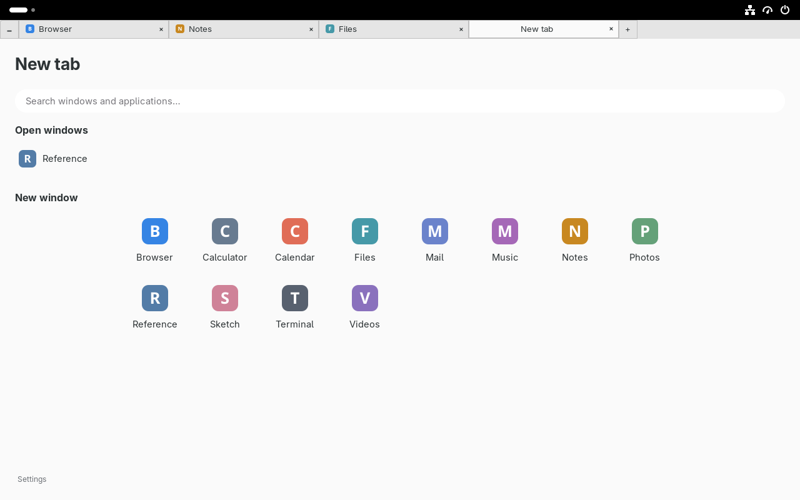
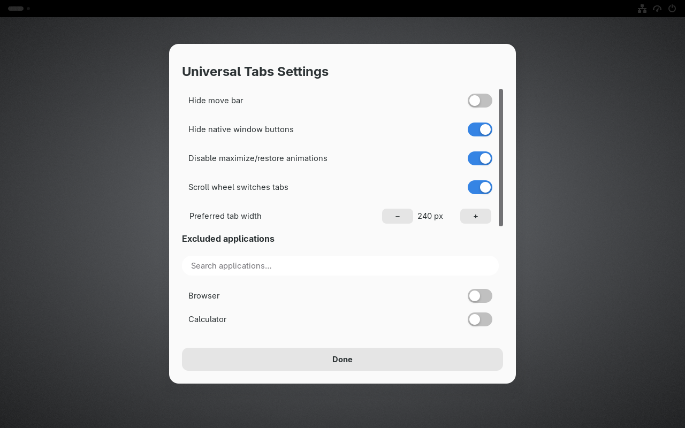

# Universal Tabs

BeOS-inspired hanging tabs for **GNOME Shell 51 on Wayland**. Group windows from
unrelated applications, switch between them, and move them together while each
application keeps its real native window.

**Version 26.11.24** — first release.

Groups survive extension updates and screen locks within the
current desktop session; they are not restored after signing out.

## Screenshots

These are **synthetic demonstrations**: fictional application windows and sample
content rendered by the actual extension in an isolated GNOME session. They are
not captures of a user's desktop or personal data.

### Floating groups



The controls match the tab height. Floating strips are inset to clear native
rounded corners; the move handle moves the entire group.

### Maximized dark appearance



Maximized tabs sit between GNOME's top bar and the application window. Colors
follow the system's light/dark preference.

### New tab



Choose another open window or launch an application into the group. The settings
link stays at the bottom left.

### Settings



Settings open in a separate modal dialog. There is no top-bar icon or menu.

## Requirements

- GNOME Shell **51**, using a **Wayland** session.
- Python 3 for installing and packaging.
- GNOME's existing GJS, GTK, and compositor libraries for development tests.

No additional runtime packages, launchers, or background services are installed.
The extension uses GNOME Shell/Mutter APIs and is not a standalone desktop app.

## Install

Clone this repository and install:

```bash
git clone https://github.com/ajpri/universal-tabs.git
cd universal-tabs
python3 extensionctl.py install
```

A fresh installation is copied to:

```text
~/.local/share/gnome-shell/extensions/universal-tabs@extensions.local/
```

`$XDG_DATA_HOME` is respected when set. The running extension loads immutable
copied revisions, so saving source files does not change the live installation.
No `sudo` is needed.

GNOME may need to discover a newly installed extension once. If it does not
activate immediately, sign out and back in once, then enable **Universal Tabs**
in GNOME Extensions. This initial registration is separate from ordinary updates.

### Optional first activation without signing out

On GNOME Shell 51, press **Alt+F2**, enter **lg**, and run this in Looking Glass:

```js
(async () => {
    const uuid = 'universal-tabs@extensions.local';
    const manager = Main.extensionManager;
    if (!manager.lookup(uuid)) {
        const dir = Gio.File.new_for_path(GLib.build_filenamev([
            GLib.get_user_data_dir(), 'gnome-shell', 'extensions', uuid,
        ]));
        await manager.loadExtension(manager.createExtensionObject(uuid, dir, 2));
    }
    manager.enableExtension(uuid);
    return manager.lookup(uuid).state;
})()
```

State `1` means active. Press Escape to leave Looking Glass. This registers only
this extension and does not change GNOME's global unsafe/debug setting.

## Update

From the same checkout:

```bash
python3 extensionctl.py update
python3 extensionctl.py status
```

Updates load automatically while the extension is active: **no sign-out or
Looking Glass is required**. When the screen is locked, the new revision loads
on unlock. Group membership, selected windows, geometry, and monitor ownership
are preserved. Temporary New tab pages and settings dialogs close during reload.

The updater imports a candidate before stopping the working revision, cleans up
signals, timers, actors, constraints, and input grabs, then restores the saved
groups. A rejected update retains or restores the previous working revision.
`last-good.json` supports recovery on the next enable.

The stable `extension.js` bootstrap is not hot-patched. The installer rejects an
incompatible bootstrap replacement; such changes need an explicit migration.
GJS retains imported modules until Shell exits, so lengthy development sessions
can accumulate cached revisions. No automatic session restart is performed.

### Existing installations with another identifier

The helper recognizes a compatible existing installation by its metadata and
stable bootstrap. It preserves that installation's identifier and folder,
including its settings and recovery data, instead of creating a duplicate.
Packaged releases always use the project-only identifier shown above.

If several compatible installations exist, select one explicitly:

```bash
UNIVERSAL_TABS_INSTALL_DIR=/path/to/extension python3 extensionctl.py update
```

Use `python3 extensionctl.py status` to see which installation is selected. The
Looking Glass example above applies to a fresh installation using the standard
identifier.

## Use

- **Group:** drag a tab onto another strip; drop between tabs to reorder.
- **Switch:** click a tab or scroll over the tabs. Scrolling stops at either end.
- **Detach:** drag a tab away, or choose **Detach tab** from its context menu.
- **Close:** use a tab's small **×** to close that individual native window.
- **Minimize:** the left control minimizes the group. Independently minimized
  windows remain minimized when the extension is disabled.
- **Maximize/restore:** double-click a tab, or the empty maximized strip.
- **Move:** drag the right-hand handle, or focus it and press Enter/Space for
  GNOME's native keyboard move. The handle is 75% of a tab's width.
- **New tab:** press **+**, then choose an open window or an application.
- **Settings:** use a tab context menu or the small bottom-left New tab link.
  Changes apply immediately; close the standalone dialog with Done or Escape.

Tabs share the group's viewport size, shrink equally when crowded, and scroll at
minimum width. Native minimum/maximum window sizes are respected. Floating
strips clear rounded corners with a 12 px inset; maximized strips stay flush
beneath the top panel. Controls and tabs are 30 px high.

Closing a tab retains the group's current monitor, including when the surviving
maximized window previously belonged to another display. The same recovery path
handles per-tab buttons and native app closes. Closing an inactive tab does not
switch the selected window.

The New tab page shows **Open windows** above a centered application grid with at
most eight columns. Search filters both sections. Tab/Shift+Tab and arrow keys
navigate; Enter activates a result and Escape returns to the app. Full titles
and control hints appear in tooltips. Existing tabs can dismiss New tab too.

Applications that open a separate fullscreen, utility, or legacy backend window
remain separate; the page closes when the launch can be identified. Unrelated
windows are never claimed by title alone. A launch with no identifiable window
after 15 seconds reports that it may have opened separately.

Tab context menus also provide reorder, maximize/restore, minimize,
**Ungroup all windows**, and **Disable Universal Tabs** actions.

## Settings

| Setting | Default | Behavior |
| --- | --- | --- |
| Hide move bar | Off | Hide the right-hand group move handle. |
| Hide native window buttons | On | Temporarily hide native close/minimize/maximize buttons using GNOME's shared layout preference. |
| Disable maximize/restore animations | On | Skip maximize, restore, and ordinary unminimize effects. Tab switches remain instant even when this is off. |
| Scroll wheel switches tabs | On | Switch tabs with wheel/smooth scrolling over their strip. |
| Preferred tab width | 240 px | Step between 72, 120, 180, 240, 300, 360, and 480 px; tabs still shrink to fit. |
| Excluded applications | None | Search applications and keep their windows independent. Existing grouped windows are released immediately. |

Preferences are stored under `$XDG_CONFIG_HOME/<installed-identifier>/settings.json`,
with `~/.config` as the default base. They survive updates and disable/re-enable.
Removing an exclusion gives open windows independent tabs again.

## Behavior and limits

- Dialogs, transient windows, and excluded apps are outside the tab model.
- App title bars remain visible. Custom app-drawn window controls may remain too.
- Native-button hiding is **desktop-wide**, including excluded apps and dialogs
  that follow the setting. Some app/dialog close buttons can override it.
- The original native-button preference is restored on disable/lock and
  reapplied on unlock. A newer preference set elsewhere is preserved.
- Fullscreen hides the strip. Alt-Tab and Overview still list individual windows.
- Groups are session-only. Explicitly disabling clears saved in-memory groups;
  screen locks and ordinary runtime updates preserve them.

The native-button layout is backed up in the installed directory before it is
changed. To recover after an interrupted Shell session:

```bash
python3 extensionctl.py restore-controls
```

Disable through a tab context menu or GNOME Extensions. For a fresh installation,
the terminal equivalent is:

```bash
gnome-extensions disable universal-tabs@extensions.local
```

For an older compatible identifier, use the one printed by the status command.

## Development and verification

```bash
gjs -m tests/groups.test.js
python3 -m unittest discover -s tests -p 'test_*.py'
python3 tests/headless.py
python3 tests/headless.py --monitors-only
python3 extensionctl.py pack
```

The integration harness creates a private headless GNOME/Wayland compositor,
separate settings, a private D-Bus, and real GTK fixture windows. It does not
restart or alter the active desktop. It needs permission to create local sockets
and access the compositor libraries already on the system.

`--settings-only` runs focused settings/recovery checks. `--monitors-only` uses
two virtual outputs to test close behavior and lock recovery.

Regenerate the synthetic screenshots with:

```bash
python3 tests/headless.py --screenshots-only
```

An optional `--development` flag on install/update explicitly opts into watching
source files. Use ordinary updates for an installation isolated from source edits.
Build output is written to `dist/universal-tabs@extensions.local.shell-extension.zip`;
generated packages, logs, caches, live preferences, and local tool configuration
are excluded from Git. Only sanitized documentation screenshots are tracked.

## License

Universal Tabs is licensed under the GNU General Public License, version 3
(`GPL-3.0-only`). See [LICENSE](LICENSE) for the full terms.
